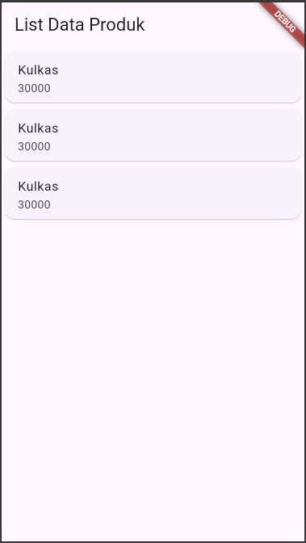

# Laporan Praktikum Pemrograman Mobile

**Nama**        : Mohammad Ferdian Samputra
**NIM**         : H1D024023
**Shift**       : F / C  
**Praktikum**   : Pemrograman Mobile

---

## 📝 Tugas Pertemuan 6
**Tanggal**: Selasa, 27 November 2026

**Kesimpulan Praktikum:**  
Pada pertemuan keenam, praktikum memberikan pemahaman dasar mengenai konsep pengembangan aplikasi mobile menggunakan Dart (Flutter). Mahasiswa dapat mengenali struktur proyek, alur kerja, serta pentingnya konsistensi dalam penulisan kode agar aplikasi mudah dikembangkan dan dipelihara.
